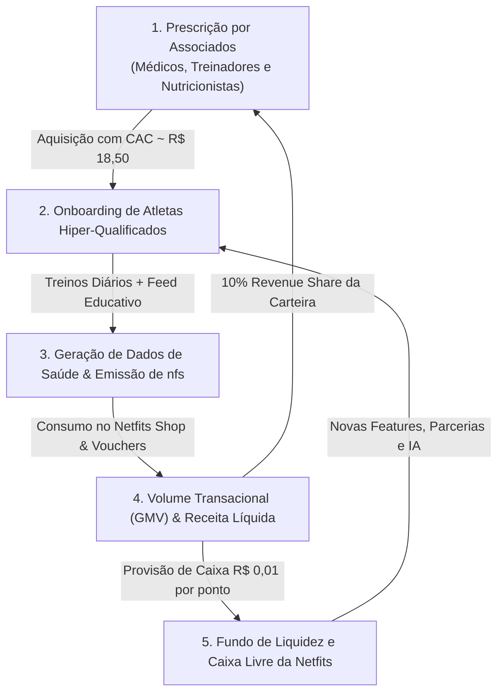

# NETFITS TECNOLOGIA LTDA.
# DOCUMENTO DE PRODUTO, VISÃO E MODELO DE NEGÓCIOS (PRODUCT BLUEPRINT)
**Versão:** 2.0 | **Data:** Outubro de 2026  
**Classificação:** Estratégico / Produto & Negócios  
**Autores:** Fundador & Squad de Produto Netfits  

---

## 1. OBJETIVO DA PLATAFORMA (VISÃO, PROPÓSITO & TESE)

### 1.1. Tese Central do Negócio (*Active Loyalty & Healthspan*)
A **NETFITS** posiciona-se como a **primeira camada de valor e fidelidade verticalizada para a vida em movimento e a longevidade saudável (*healthspan*) na América Latina**.

Tradicionalmente, a jornada do praticante de atividades físicas e esportes amadores encontra-se completamente fragmentada:
- O atleta treina monitorado por dispositivos caros (*wearables* como Apple Watch, Garmin e Polar), gerando milhões de dados de esforço que não geram retorno financeiro;
- O atleta consome suplementos, vestuário técnico e equipamentos em e-commerces dispersos, sem um ecossistema integrado que valorize sua fidelidade;
- Os médicos do esporte, nutricionistas e treinadores não possuem uma ferramenta eficiente para acompanhar o engajamento contínuo de seus pacientes e monetizar de forma ética a prescrição de bons hábitos.

A Netfits unifica esses vetores ao introduzir os pontos **`nfs`**: uma moeda de utilidade real que remunera o suor, a atenção qualificada e a consistência física diária.

### 1.2. MTP e Slogan Oficial
- **Massive Transformative Purpose (MTP)**: *"Recompensar quem se movimenta."*
- **Slogan Oficial**: *"Fazer cada movimento valer mais."*

### 1.3. Pilares de Sustentabilidade do Ecossistema (4 em 1)
1. **Telemetria de Movimento & Longevidade (Wearables)**: Registro diário de treinos e métricas de saúde (*Apple HealthKit, Google Health Connect, Garmin, Polar e Strava*). A pontuação de treinos é um recurso **exclusivo para membros do Clube Netfits** e encontra-se **pendente de aprovação formal da diretoria da empresa**.
2. **Mídia de Alta Atenção (100% Dwell Time)**: Feed técnico e educacional que remunera o atleta pelo foco consciente em conteúdos científicos (Linha Netfits e Linha Fibios) e de marcas parceiras.
3. **Netfits Shop (Marketplace Especializado)**: Catálogo fechado com checkout híbrido (*Pontos nfs + Dinheiro/Cartão*) e cashback garantido.
4. **Rede de Prescritores Associados**: Médicos, nutricionistas e treinadores atuando como o canal primário de aquisição de atletas e recebendo receita recorrente (10% de Revenue Share).

---

## 2. PERFIS DE USUÁRIOS (PERSONAS DO ECOSSISTEMA)

O ecossistema atende a quatro categorias principais de usuários, com necessidades, incentivos e jornadas específicas:

```mermaid
flowchart LR
    subgraph Atleta["1. Atleta Netfiter"]
        A1["Treina e Sincroniza Wearable"]
        A2["Consome Conteúdo no Feed"]
        A3["Acumula nfs e Resgata no Shop"]
    end

    subgraph Associado["2. Prescritor Associado"]
        B1["Médico / Nutricionista / Treinador"]
        B2["Prescreve App com Link Exclusivo"]
        B3["Recebe 10% de Revenue Share"]
    end

    subgraph Parceiro["3. Seller do Marketplace"]
        C1["Marca de Suplementação / Equipamento"]
        C2["Disponibiliza Catálogo de SKUs"]
        C3["Vende com Take-Rate de 6% a 8%"]
    end

    subgraph Gestor["4. Gestor / Administrador"]
        D1["Opera o Cockpit /admin"]
        D2["Governança de Pontos & FinOps"]
        D3["Monitora DRE e Trilha de Auditoria"]
    end

    Associado -->|Atrai & Prescreve| Atleta
    Atleta -->|Compra Produtos| Parceiro
    Parceiro -->|Gera Receita| Gestor
    Gestor -->|Repassa 10%| Associado
```

### 2.1. O Atleta Netfiter (Usuário Final)
- **Perfil**: Praticantes de corrida de rua, ciclismo, musculação, crossfit, natação e esportes de endurance, variando de iniciantes a atletas de alta performance.
- **Dores Principais**: Alto custo de manutenção do esporte (tênis, géis de carboidrato, suplementos, consultas médicas); falta de incentivo tangível para manter a constância nos dias difíceis.
- **Incentivos na Plataforma**:
  - Acumular pontos `nfs` consumindo conteúdos científicos no Feed e respondendo a quizzes;
  - Resgatar descontos reais e produtos no Netfits Shop com cashback garantido;
  - Centralizar métricas de esforço e badges de constância em seu perfil;
  - Opção de assinar o Clube Netfits (onde benefícios adicionais, incluindo eventual pontuação por treinos, estão sob deliberação executiva).

### 2.2. O Prescritor Associado (Canal B2B2C)
- **Perfil**: Médicos do Esporte (CRM), Cardiologistas, Nutricionistas Clínicos/Esportivos (CRN) e Treinadores Físicos (CREF/Assessorias).
- **Dores Principais**: Baixa adesão dos pacientes às recomendações entre as consultas; dificuldade de monetizar o acompanhamento contínuo sem violar normas éticas dos conselhos de classe.
- **Incentivos na Plataforma**:
  - Ferramenta para estimular o paciente a se exercitar e consumir informação médica de qualidade;
  - Remuneração ética e transparente de **10% de Revenue Share** sobre a receita gerada pelas compras de seus pacientes no Shop;
  - Conformidade rigorosa com CFM nº 2.336/2023, CFN nº 599/2018 e CONFEF nº 307/2015.

### 2.3. O Seller Parceiro (Marcas & E-commerces)
- **Perfil**: Fabricantes e distribuidores de suplementos nutricionais, vestuário técnico, eletrônicos esportivos e serviços de saúde (exames, academias).
- **Dores Principais**: CAC (Custo de Aquisição de Clientes) exorbitante no Google e Meta; tráfego desqualificado com baixa conversão.
- **Incentivos na Plataforma**:
  - Acesso direto a uma comunidade de centenas de milhares de esportistas ativos e altamente propensos ao consumo de sua categoria;
  - Modelo de pagamento baseado em performance (Take-Rate de 6,0% a 8,0% sobre vendas efetivamente pagas);
  - Possibilidade de patrocinar posts no Feed com garantia de 100% de tempo de atenção do usuário.

### 2.4. O Anunciante de Mídia (Retail Media de Alta Atenção)
- **Perfil**: Grandes marcas de bens de consumo, planos de saúde e seguradoras que buscam associar sua imagem à saúde e ao bem-estar.
- **Dores Principais**: Fraude de cliques e impressões fantasmas nas redes sociais tradicionais; vídeos pulados em 2 segundos sem retenção da mensagem.
- **Incentivos na Plataforma**:
  - Garantia contratual de **100% Dwell Time** (o atleta só é bonificado se assistir ao conteúdo completo, com tela ativa e áudio habilitado).

---

## 3. MODELO DE MONETIZAÇÃO E ENGENHARIA FINANCEIRA

A viabilidade econômica da Netfits sustenta-se em cinco linhas de receita integradas e altamente defensáveis:

| Linha de Receita | Descrição do Modelo | Parâmetro Financeiro |
| :--- | :--- | :--- |
| **1. Take-Rate do Marketplace** | Comissão retida sobre as transações de produtos esportivos e suplementos intermediados no Netfits Shop. | **6,0% a 8,0% do GMV** |
| **2. Retail Media (Feed de Alta Atenção)** | Cobrança de anunciantes e parceiros por veiculação de posts educativos e campanhas de marca com garantia de 100% de atenção. | **R$ 0,50 a R$ 2,50 por visualização validada** |
| **3. Assinatura do Clube Netfits** | Mensalidade recorrente paga por atletas que desejam acelerar benefícios no ecossistema e ter acesso a produtos exclusivos. | **R$ 19,90 / mês** |
| **4. Spread Atuarial de Pontos & Float** | Diferencial entre o valor atribuído no acúmulo e o valor de custo no resgate, aliado ao rendimento financeiro das provisões em caixa. | **CPP Acúmulo: R$ 15,00 a cada 1.000 nfs (R$ 0,0150) CPP Resgate: R$ 0,0100** |
| **5. Taxa de Breakage (Expiração Natural)** | Percentual de pontos emitidos que expiram após o prazo de 24 meses sem utilização, revertendo-se em margem operacional (CPC 47). | **Target Breakage: 5,0% ao ano** |

---

## 4. FLUXO DE RELACIONAMENTO & O FLYWHEEL NETFITS

O motor de crescimento exponencial da Netfits é estruturado sobre o **Flywheel Formigari**, um ciclo virtuoso onde cada participante fortalece o valor da rede para os demais:

### 4.1. As Fases da Jornada do Atleta no Ecossistema

1. **Atração & Entrada (Onboarding Confiável)**:
   - O atleta é convidado através do link exclusivo do seu médico ou treinador (ou via campanha MGM);
   - Realiza o cadastro em 2 etapas, declara seus esportes de preferência e sensores;
   - Recebe **50 nfs** como bônus de boas-vindas e aceita o Termo de Consentimento LGPD.
2. **Engajamento e Rotina (Movimento Contínuo)**:
   - O atleta realiza seu treino matinal e sincroniza com o app (Garmin, Apple Watch, Strava), acumulando histórico, métricas de frequência cardíaca e badges de conquista;
   - *(Nota de Governança: a concessão de pontos por treino é exclusiva para assinantes do Clube e está sob deliberação formal da diretoria)*;
   - No intervalo do dia, o atleta abre o Feed, consome 1 post educacional sobre nutrição (Linha Fibios) e ganha **5 nfs** pelo foco (100% Dwell Time);
   - Responde ao quiz rápido do Dr. Franco ou Dra. Isabella e acumula mais **5 nfs**.
3. **Conversão e Resgate (Ciclo de Valor)**:
   - Ao atingir saldo suficiente, o atleta visita o Netfits Shop;
   - Seleciona produtos de interesse e opta pelo checkout híbrido, pagando parte do pedido com pontos acumulados via algoritmo FEFO;
   - A compra gera um novo lote de cashback em pontos, retroalimentando sua retenção.
4. **Evangelização e Crescimento da Tribo**:
   - Satisfeito com os descontos reais, o atleta compartilha seu código de indicação com companheiros de treino ou assessorias;
   - Ganha **50 nfs** por cada novo amigo ativo (bônus único de ativação), impulsionando a expansão orgânica da rede.
