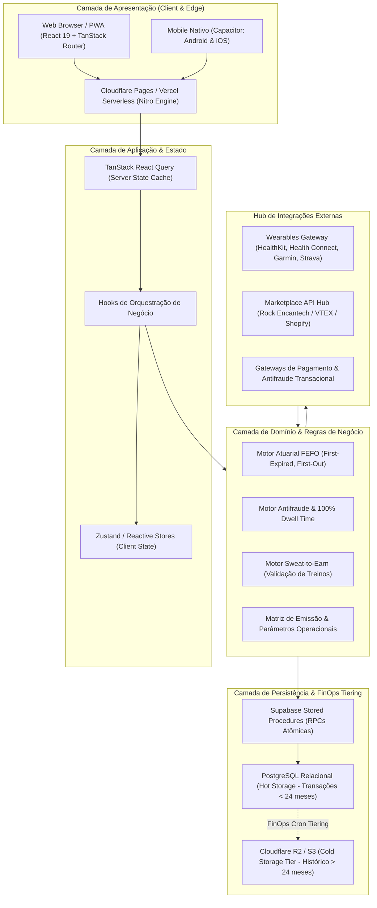
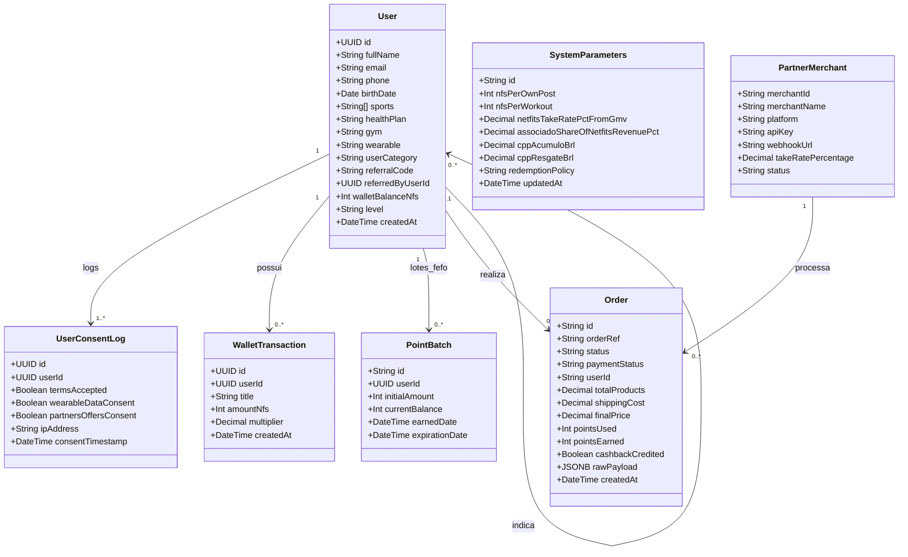

# NETFITS TECNOLOGIA LTDA.
# DOCUMENTO MESTRE DE ARQUITETURA DE SOFTWARE (ARCHITECTURE MASTER SPECIFICATION)
**Versão:** 2.0 (Consolidada) | **Data:** Outubro de 2026  
**Classificação:** Confidencial / Engenharia de Software  
**Autores:** Squad de Arquitetura, Engenharia & QA Netfits  

---

## 1. VISÃO GERAL DA ARQUITETURA

A plataforma **Netfits** é concebida como uma arquitetura modular, *AI-First*, orientada a eventos e centrada na integridade atuarial de sua moeda de fidelidade (os pontos **`nfs`**). O sistema opera no modelo **Clean / Layered Architecture** desacoplado, combinando execução Server-Side (Edge SSR), clientes web/mobile responsivos e uma camada de dados transacional imutável.

### 1.1. Macroarquitetura de Solução



---

## 2. ESTRUTURA DE PASTAS E RESPONSABILIDADES

A base de código do frontend e edge backend reside em `src/` e segue uma estrutura estrita de separação de responsabilidades:

```
app_netfits/
├── android/                         # Projeto nativo Android empacotado via Capacitor
├── ios/                             # Projeto nativo iOS empacotado via Capacitor
├── public/                          # Ativos estáticos públicos (logos, favicons, manifesto PWA)
├── scripts/                         # Automações de CI/CD, migrações de banco e quality gates
│   ├── validate-routes.cjs          # Verificação de integridade estática das rotas
│   ├── migrate-database.mjs         # Executor de DDL/migrações em Staging e Produção
│   └── promote-to-production.mjs    # Pipeline de homologação e promoção de release
├── src/
│   ├── assets/                      # Imagens, ilustrações e fotos otimizadas (WebP/SVG)
│   ├── components/                  # Componentes visuais desacoplados
│   │   ├── admin/                   # Submódulos exclusivos do Cockpit Administrativo
│   │   │   ├── AdminAuthGuard.tsx   # Lockscreen de segurança com Master PIN
│   │   │   └── AdminMkplaceIntegrationTab.tsx # Painel de status e webhooks Rock
│   │   ├── ui/ (ou raiz components) # Primitivas de interface acessíveis (Radix UI / Tailwind)
│   │   ├── FeedSocialActions.tsx    # Barra de interações sociais e acúmulo de nfs
│   │   ├── NetfitsEducationalCard.tsx # Card de post educacional com trava de dwell time
│   │   ├── DrFrancoQuizCard.tsx     # Desafio interativo Dr. Franco (Medicina Esportiva)
│   │   ├── DraIsabellaQuizCard.tsx  # Desafio interativo Dra. Isabella (Longevidade)
│   │   ├── ProductDetailSheet.tsx   # Modal de detalhe de produto do marketplace
│   │   ├── ProductCheckoutSheet.tsx # Fluxo de checkout híbrido (Pontos + Cartão/Pix)
│   │   ├── WearableSyncSheet.tsx    # Interface de conexão e sincronização de wearables
│   │   └── InstitutionalWebHeader.tsx # Cabeçalho institucional público
│   ├── lib/                         # Camada de Domínio, Infraestrutura e Stores
│   │   ├── ai/                      # Clientes de IA, prompts e pipelines dos agentes autônomos
│   │   ├── emails/                  # Templates e rotinas transacionais de comunicação
│   │   ├── integrations/            # Clientes de APIs de terceiros (Garmin, Strava, Rock)
│   │   ├── accounting-xml-generator.ts # Gerador de SPED ECD e NFS-e ABRASF v2.04
│   │   ├── app-lock-store.ts        # Gerenciamento de bloqueio biométrico / PIN no app
│   │   ├── auth-store.ts            # Gerenciamento de sessão, perfis e credenciais
│   │   ├── db.ts                    # Fábrica de conexões (Supabase Client & Postgres Pool)
│   │   ├── feed-antifraud.ts        # Motor de validação de dwell time e foco do usuário
│   │   ├── marketplace-api-hub.ts   # Gateway de e-commerce, two-phase lock e webhooks
│   │   ├── native-bridge.ts         # Bridge de comunicação com recursos nativos Capacitor
│   │   ├── operational-params-store.ts # Parâmetros mestres da operação e cálculo FEFO
│   │   ├── persistent-orders-store.ts  # Espelho local de conciliação de pedidos
│   │   ├── qa-autonomous-engine.ts  # Motor de testes autônomos do Squad de IA
│   │   ├── user-schema.ts           # Schemas Zod de validação de usuários e consentimentos
│   │   └── wallet-store.ts          # Estado reativo do saldo e extrato de pontos
│   └── routes/                      # Roteamento baseado em arquivos (TanStack Router)
│       ├── __root.tsx               # Layout raiz com providers (QueryClient, Toaster)
│       ├── index.tsx                # Feed principal com metas diárias e player de vídeo
│       ├── home.tsx                 # Dashboard principal do atleta
│       ├── activities.tsx           # Histórico de treinos e métricas de telemetria
│       ├── market.tsx               # Netfits Shop Marketplace
│       ├── wallet.tsx               # Carteira de pontos nfs, extrato e resgates
│       ├── profile.tsx              # Perfil do atleta, badges e conexão de sensores
│       ├── associado.tsx            # Portal do Prescritor / Associado (10% rev share)
│       ├── parceiros.tsx            # Portal B2B de academias, marcas e clínicas
│       ├── admin.tsx                # Cockpit Administrativo Master (confidencial)
│       ├── auth.tsx                 # Fluxo de login e onboarding em 2 etapas
│       ├── contato.tsx              # Formulário de atendimento e canal com o DPO
│       └── download.tsx             # Landing page de instalação do app nativo
├── schema.sql                       # DDL completo do PostgreSQL / Supabase
├── package.json                     # Manifesto de dependências e scripts do projeto
├── tsconfig.json                    # Configuração TypeScript Strict
└── vite.config.ts                   # Configuração de build, SSR e plugins
```

---

## 3. REGRAS DE NEGÓCIO CENTRAIS

### 3.1. Motor Atuarial de Pontos `nfs` & Algoritmo FEFO
1. **Regra de Ouro da Carteira (Imutabilidade do Saldo)**: O saldo `wallet_balance_nfs` de um usuário é o reflexo da soma algébrica de seu histórico de lançamentos. O saldo jamais pode ser negativo (`CHECK (wallet_balance_nfs >= 0)`).
2. **Algoritmo FEFO (First-Expired, First-Out)**:
   - Todo lote de pontos gerado possui uma data de validade de **24 meses**.
   - Ao realizar qualquer resgate, estorno ou utilização de vouchers no Netfits Shop, o sistema obrigatoriamente debita primeiro os pontos com data de expiração mais próxima.
   - Isso maximiza o valor para o atleta, evitando expiração acidental de pontos antigos.
3. **Parâmetros Econômicos do Ponto**:
   - **CPP Acúmulo**: **R$ 15,00 a cada 1.000 nfs** (R$ 0,0150 por ponto acumulado).
   - **CPP Resgate**: **R$ 0,0100 por ponto** (R$ 10,00 a cada 1.000 nfs).
   - **Custo de Provisão de Caixa**: R$ 0,0100 por ponto emitido retido em fundo de liquidez.
   - **Target Breakage (Taxa Esperada de Expiração)**: **5,0% ao ano** (e não 12%).
   - **Clube Netfits**: Mensalidade de R$ 19,90/mês.

### 3.2. Regras de Emissão de Conteúdo & Feed
1. **Posts Próprios do Atleta**:
   - Recompensa: **10 nfs** por post publicado.
   - Limite Diário: **1 post recompensado por dia**.
   - Limite Semanal: **7 posts recompensados por semana**.
2. **Consumo de Conteúdo Educacional & Patrocinado**:
   - Visualização de Post Educacional (Netfits Linha 1 / Fibios Linha 2): **5 nfs**.
   - Visualização de Post Patrocinado (Marcas / Sellers): **10 nfs**.
   - Quizzes / Desafios Científicos Interativos: **5 nfs** (trava estrita de 1 quiz remunerado por dia).
   - Curtidas e Salvar: **0 nfs** (sem incentivo artificial a métricas de vaidade).
   - Compartilhamento Externo: **1 nf** por compartilhamento validado.
   - Teto Máximo de Interações com Conteúdos de Terceiros: **10 interações diárias** ou **50 nfs/dia**.

### 3.3. Motor Antifraude de Atenção (100% Dwell Time)
1. **Monitoramento Ativo de Foco**: O player monitora o foco do navegador (`document.hidden`, evento `blur`, interrupção de áudio). Se a aba for alternada ou minimizada, o contador pausa imediatamente.
2. **Tempo Mínimo de Dwell Time em Textos**: Exige permanência contínua de no mínimo **10 segundos** no card e rolagem obrigatória até o fim do texto (`requireScrollToBottomForRead = true`).
3. **Validação de Vídeo Completo**: Exige no mínimo **90% a 100%** de reprodução do vídeo sem saltos artificiais de reprodução (`playbackRate` travado em 1.0x).
4. **Rate Limit contra Bots**: Trava máxima de **10 interações por minuto** por endereço IP / usuário.
5. **Bloqueio de Auto-Engajamento**: `blockSelfEngagementRewards = true` impede pontuação por interações nos próprios posts.

### 3.4. Atividades Físicas & Telemetria Wearables (Sweat-to-Earn)
> [!IMPORTANT]
> **GOVERNANÇA & ELEGIBILIDADE DE TREINOS**:
> 1. **EXCLUSIVIDADE DO CLUBE**: A pontuação por treino realizado é **SOMENTE VÁLIDA PARA MEMBROS DO CLUBE NETFITS**. Usuários gratuitos/básicos não são elegíveis a acúmulo de pontos por treinos.
> 2. **STATUS DE GOVERNANÇA**: Mesmo essa pontuação exclusiva para membros do clube **AINDA ESTÁ PENDENTE DE APROVAÇÃO FORMAL DA DIRETORIA DA EMPRESA**. Enquanto não houver aprovação deliberada da diretoria, o motor de pontuação por treino permanece desativado/congelado em ambiente produtivo.
> 3. **PARÂMETROS CONDICIONADOS À APROVAÇÃO**:
>    - Caso aprovada pela diretoria para membros do Clube: **20 nfs por treino validado**.
>    - Limites de Frequência: Máximo de **1 treino remunerado por dia** e **5 treinos remunerados por semana**.
>    - Bônus de Consistência Semanal: **20 nfs adicionais** ao cumprir a meta de 5 treinos em uma mesma semana.
>    - Duração mínima: **30 minutos** (ou **20 minutos** para sessões identificadas como HIIT).
>    - Gasto calórico ativo mínimo: **150 kcal**.
>    - Rejeição estrita a treinos inseridos manualmente sem dados brutos de sensores de hardware (frequência cardíaca e/ou trilha de GPS).
>    - Filtro de velocidade/pace: Rejeita corridas com pace médio inferior a 2:15 min/km e ciclismo contínuo superior a 55 km/h sem identificação de competição oficial homologada.
>    - Janela retroativa máxima: Até **48 horas** para sincronização após o término do exercício.

### 3.5. Marketplace Shop & Programa de Associados (10% Revenue Share)
1. **Take-Rate da Netfits**: Varia de **6,0% a 8,0%** sobre o GMV dos produtos faturados pelos sellers.
2. **Comissão dos Associados Prescritores**: **10,0% da receita líquida auferida pela Netfits** sobre todas as compras realizadas pelos atletas pertencentes à carteira do associado.
3. **Programa Member-Get-Member (MGM)**:
   - Boas-vindas ao novo atleta cadastrado: **50 nfs** (bônus único de onboarding).
   - Indicação de amigo por usuário comum: **50 nfs** (bônus único de ativação).
   - Comissão recorrente sobre compras de amigos: **desativada (0%)** para usuário comum. Apenas avaliada no escopo do futuro lançamento do Clube Netfits.

---

## 4. ENTIDADES DO SISTEMA (DATA MODELS)



---

## 5. CONTRATOS DE APIS & INTEGRAÇÕES

### 5.1. Procedimentos Remotos Supabase (RPCs Obrigatórias)

Para eliminar riscos de *race condition* e garantir integridade atuarial, as mutações na carteira e concessão de pontos **jamais ocorrem via UPDATE direto no client-side**, mas sim através de Stored Procedures atômicas com locks transacionais:

1. **`rpc_credit_points(p_user_id UUID, p_amount INT, p_title VARCHAR, p_category VARCHAR)`**:
   - Executa `SELECT wallet_balance_nfs FROM users WHERE id = p_user_id FOR UPDATE`;
   - Insere o registro em `wallet_transactions`;
   - Cria o lote correspondente em `point_batches` com vencimento em `NOW() + INTERVAL '24 months'`;
   - Atualiza `wallet_balance_nfs` do usuário;
   - Retorna o novo saldo consolidado.

2. **`rpc_debit_points_fefo(p_user_id UUID, p_amount INT, p_title VARCHAR, p_order_id VARCHAR)`**:
   - Verifica se o saldo atual é suficiente (`balance >= p_amount`);
   - Seleciona os lotes ativos do usuário ordenados por `expiration_date ASC FOR UPDATE`;
   - Consome os lotes iterativamente até cobrir `p_amount`;
   - Registra a transação com valor negativo em `wallet_transactions`;
   - Atualiza o saldo do usuário e retorna a relação de lotes debitados.

3. **`rpc_validate_and_reward_dwell_time(p_user_id UUID, p_post_id VARCHAR, p_dwell_seconds INT, p_video_completed BOOLEAN)`**:
   - Valida os parâmetros de segurança antifraude;
   - Verifica se o usuário já ultrapassou o limite diário de interações;
   - Credita a recompensa apropriada (5 ou 10 nfs).

### 5.2. Marketplace API Hub & Webhooks (Rock Encantech)

O módulo `src/lib/marketplace-api-hub.ts` implementa o protocolo de conexão segura para parceiros e sellers externos:

* **Endpoint de Webhook**: `POST /api/webhooks/marketplace`
* **Assinatura de Segurança**: Cabeçalho `X-Netfits-Signature: sha256=HMAC_SHA256(payload, apiSecret)`
* **Eventos Suportados**:
  - `ORDER_CREATED`: Notifica novo pedido originado no Netfits Shop.
  - `ORDER_PAID`: Dispara o cálculo e agendamento de cashback em pontos `nfs` para o atleta e comissão do associado.
  - `ORDER_SHIPPED` / `ORDER_DELIVERED`: Confirma a entrega e inicia a contagem regressiva para liberação do cashback retido.
  - `ORDER_CANCELLED` / `ORDER_REFUNDED`: Estorna a provisão de comissão e devolve pontos utilizados seguindo a regra híbrida do CDC.
* **Two-Phase Lock para Resgate de Vouchers**:
  1. *Fase 1 (Reserva)*: `POST /api/vouchers/reserve` -> Bloqueia o saldo de pontos temporariamente por 15 minutos gerando um `holdToken`.
  2. *Fase 2 (Confirmação)*: `POST /api/vouchers/commit` -> Executa o débito definitivo via RPC FEFO após a confirmação do pagamento no e-commerce parceiro.

---

## 6. PADRÕES ARQUITETURAIS ADOTADOS

1. **Single Source of Truth (SSOT)**: A tabela `system_parameters` no banco de dados centraliza todos os limites, taxas e parâmetros econômicos do ecossistema. Qualquer modificação no `/admin` propaga-se de imediato aos clientes.
2. **Imutabilidade Contábil (Ledger Pattern)**: Nenhum registro da tabela `wallet_transactions` é alterado ou excluído. Estornos e correções são efetuados exclusivamente via lançamentos de contrapartida.
3. **FinOps Database Tiering**: As transações ativas dos últimos 24 meses residem no banco quente (PostgreSQL). Mensalmente, a rotina `archive_expired_wallet_transactions()` migra registros históricos para armazenamento frio comprimido (Cloudflare R2), reduzindo custos de IOPS e RAM em 61,5%.
4. **Isolamento Físico de Ambientes**: Staging e Produção possuem bancos de dados, chaves Supabase e credenciais de webhook 100% segregadas, prevenindo contaminação de dados de teste na esteira de produção.
