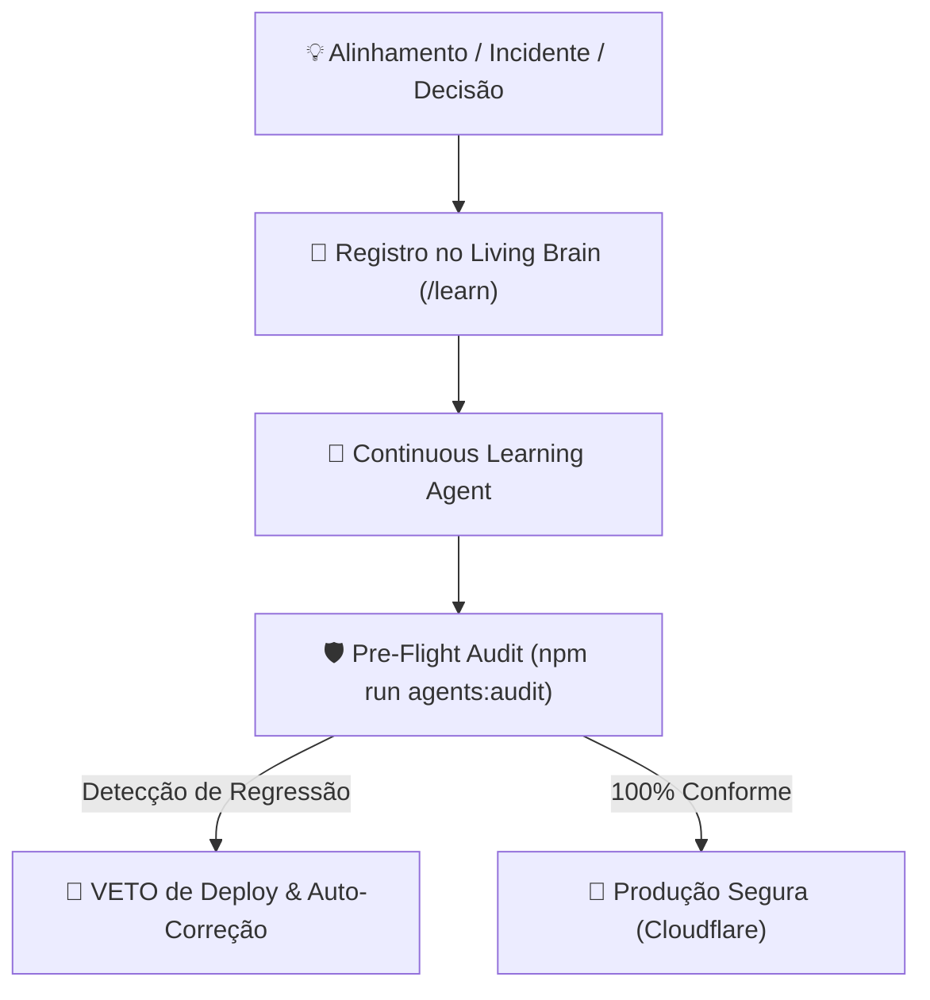

# 🧠 NETFITS — BASE DE MEMÓRIA INSTITUCIONAL E LIÇÕES APRENDIDAS (LIVING BRAIN)

> **PROPÓSITO**: Esta base de conhecimento indexa todas as decisões arquiteturais, incidentes superados, regras regulatórias e alinhamentos estratégicos do fundador André Gallo. O **Continuous Learning Agent** audita o código continuamente contra estas lições para garantir **tolerância zero a regressões**.

---

---

## 📚 Catálogo Canônico de Lições Aprendidas

### 🩺 `LL-001` — Compliance Médico CFM dos Sócios Fibios
* **Severidade**: `CRITICAL`
* **Origem**: Exigência regulatória do Conselho Federal de Medicina (CFM / Codame / RQE).
* **Fato**: Dra. Isabella Formigari (CRM-SP 282951) e Dr. Franco Merici (CRM-SP 212567) estão concluindo suas especializações médicas.
* **Regra Inegociável**: É estritamente vedado atribuir a eles titulação de especialista (ex: Medicina do Esporte, Ortopedia ou Nutrologia) em qualquer tela ou comunicação pública. A assinatura oficial única é:
  * `Dr. Franco Merici: Médico (CRM-SP 212567) sócio fundador da Fibios`
  * `Dra. Isabella Formigari: Médica (CRM-SP 282951) sócia fundadora da Fibios`

---

### ☁️ `LL-002` — Exclusividade Cloudflare Workers
* **Severidade**: `CRITICAL`
* **Origem**: Descomissionamento de provedores legados (Vercel) em prol de arquitetura serverless de borda ultra-rápida.
* **Regra Inegociável**: Toda a infraestrutura oficial da Netfits roda exclusivamente no **Cloudflare Workers / Nitro preset cloudflare-module** (`www.netfits.com.br`). Qualquer dependência ou referência a Vercel é proibida.

---

### 📱 `LL-003` — Paridade Cross-Platform Mobile (Android & iOS)
* **Severidade**: `CRITICAL`
* **Origem**: Incidentes de tela preta e bloqueios de bot-shield no Android ao presumir comportamento exclusivo de iOS/WebKit.
* **Regra Inegociável**: Nenhuma tela, botão, fluxo de login ou integração de hardware pode ser mono-plataforma. Tudo deve ser projetado, testado e validado tanto no **Android (Chromium WebView & Chrome Custom Tabs)** quanto no **iOS (WebKit & Safari)**.

---

### 🎨 `LL-004` — Key Visual, Design Tokens e Tipografia Oficial (Manifesto 3.0)
* **Severidade**: `HIGH`
* **Origem**: Desvios visuais em cores institucionais e legibilidade WCAG.
* **Regra Inegociável**: Cores oficiais:
  * Roxo Escuro Institucional: `#35106E`
  * Roxo Vibrante Destaque: `#6B2AD9`
  * Verde-Limão Movimento: `#C8F135`
  * Verde Oliva Logo: `#5D7600`
  * Lavanda Sutil: `#F2ECFD`
  * Barra bipartida (`#6B2AD9` + `#C8F135`) obrigatória em 100% dos cards do feed. Tipografia *Inter*.

---

### 🗣️ `LL-005` — Proibição de Jargões Corporativos na Interface
* **Severidade**: `HIGH`
* **Origem**: Inserção de termos contábeis internos (ex: FEFO, take-rate, CAC) em textos voltados ao usuário.
* **Regra Inegociável**: O usuário nunca deve ver termos como "FEFO" ou "take-rate". A linguagem deve ser clara, acolhedora e pedagógica: *"pontos com vencimento mais próximo primeiro"*.

---

### 🏷️ `LL-006` — Padronização Canônica: "Pílula de Sabedoria"
* **Severidade**: `MEDIUM`
* **Origem**: Variações confusas misturando as marcas (ex: "Pílula de Sabedoria Fibios", "Pílula Netfits").
* **Regra Inegociável**: O takeaway no rodapé dos cards educativos deve se chamar estritamente **`Pílula de Sabedoria`**.

---

### 🔒 `LL-007` — Blindagem de Quiz-Locking e Travas Antifraude
* **Severidade**: `CRITICAL`
* **Origem**: Usuários conseguiam responder quizzes sem ler artigos/ver vídeos, e a leitura de 0 nfs consumia o teto diário de interações.
* **Regra Inegociável**: O Quiz permanece **bloqueado com cadeado (`🔒`)** até que o dwell time de 10s e rolagem 100% (ou 90% do vídeo) sejam auditados. Ações de 0 nfs **nunca** contam no limite diário de interações bonificadas.

---

### 🧭 `LL-008` — Arquitetura Canônica das 4 Abas Inferiores
* **Severidade**: `CRITICAL`
* **Origem**: Textos desatualizados citavam "Perfil" na barra inferior.
* **Regra Inegociável**: As 4 abas estruturais da barra inferior são:
  1. **Feed** (`/feed`)
  2. **Shop** (`/market`)
  3. **Clube** (`/club`)
  4. **Carteira** (`/wallet`)  
  *O Perfil é acessado exclusivamente pelo avatar no cabeçalho superior.*

---

### 🛑 `LL-009` — Protocolo Cirúrgico Obrigatório de Deploy
* **Severidade**: `CRITICAL`
* **Origem**: Merges indiscriminados de staging arrastando telas experimentais para produção.
* **Regra Inegociável**: Proibição absoluta de `git merge staging`. Subidas em `main` são feitas cirurgicamente (cherry-pick), com sanitização de diff e aprovação formal explícita ("sim") do fundador.

---

### 💎 `LL-010` — Parâmetros Operacionais Canônicos do Clube Netfits
* **Severidade**: `HIGH`
* **Origem**: Inconsistências de valores e pontuações do Clube entre componentes.
* **Regra Inegociável**:
  * Assinatura: **R$ 19,90 / mês**
  * Pontos fixos: **250 nfs** na adesão e a cada mensalidade
  * Treinos com relógio/sensores: **20 nfs por treino validado via Terra API**
  * Shop: **20% mais pontos** (4,8 nfs por R$ 1,00)
  * MGM: **10% de comissão** em pontos sobre as compras de todos os seus indicados.

---

## 🔄 Como Ensinar o Agente Continuamente?
Sempre que uma nova regra for decidida ou um incidente for resolvido:
1. No chat, você pode usar o comando **/learn** ou instruir: *"aprenda que X agora é a regra"*;
2. O agente adicionará a nova entrada em `src/lib/knowledge/LESSONS_LEARNED.json` e registrará o teste de anti-regressão correspondente.

---

### 🛡️ LIÇÃO LL-011: ATOMICIDADE TRANSACIONAL DISTRIBUÍDA & PROIBIÇÃO DE MUTAÇÃO CLIENT-SIDE
* **ID Canônico**: `LL-011`
* **Gravidade**: `CRITICAL` (Poder de Veto Imediato)
* **Origem**: Auditoria de Produção de 07/11/2026 — Reconciliação de Pontos e MGM
* **Contexto**: Incidentes em produção de usuários cadastrados sem persistência no banco e padrinhos que não receberam bônus MGM (+50 nfs) ocorreram porque o navegador do novo membro tentava mutar o saldo do padrinho em seu localStorage local, e a sincronização com o banco era chamada sem await/keepalive antes de redirecionar a tela.
* **Regras Inegociáveis**:
  1. **Proibição de Mutação de Terceiros no Client-Side**: É terminantemente proibido calcular ou somar pontos para qualquer outro usuário que não seja o usuário ativo daquela sessão no dispositivo local. Bonificações de padrinho (MGM) DEVEM ser processadas e creditadas exclusivamente no servidor central (`/api/users-sync`).
  2. **Persistência Antes do E-mail**: E-mails transacionais que comemoram créditos de pontos (boas-vindas, indicações) SÓ PODEM ser disparados após o banco de dados confirmar a gravação atômica da conta e da transação no ledger.
  3. **Transporte Resiliente (Keepalive & Await)**: Chamadas de sincronização de cadastro e transações na nuvem DEVEM utilizar `await` obrigatório e flag `keepalive: true` no `fetch()` para blindar contra cancelamentos abruptos por troca de página ou fechamento de abas móveis.
* **Anti-patterns Proibidos**: `referrer.nfsBalance +=`, chamadas de sync sem `await` antes de `navigate()`.

---

### 🛡️ LIÇÃO LL-012: PROTEÇÃO ABSOLUTA DA BASE DE USUÁRIOS REAIS EM GO LIVE MODE
* **ID Canônico**: `LL-012`
* **Gravidade**: `CRITICAL` (Poder de Veto Imediato)
* **Origem**: Auditoria de Integridade de Produção D1 de 08/11/2026
* **Contexto**: A plataforma Netfits está em regime de Go Live Mode com usuários reais ativos (fundadores, médicos sócios da Fibios, familiares, atletas pioneiros e avaliadores da App Store). Qualquer script de seed parcial, migração desatenta ou overwrite que omita usuários cadastrados é uma falha grave inaceitável.
* **Regras Inegociáveis**:
  1. **Premissa de Usuários Reais**: Todo usuário cadastrado no banco de produção é um usuário real de carne e osso. Nenhum dado cadastral ou saldo pode ser descartado ou sobrescrito por mocks estáticos.
  2. **Proibição de Comandos Destrutivos**: É estritamente vedada a execução de `DROP TABLE users`, `TRUNCATE TABLE users` ou `DELETE` indiscriminado. Migrações e scripts devem operar estritamente via UPSERT cumulativo (`ON CONFLICT(id) DO UPDATE`).
  3. **Contagem Monotonamente Não-Decrescente**: Qualquer script de migração, reconciliação ou sincronização deve assegurar que a contagem de usuários cadastrados permaneça igual ou maior após a operação.
* **Anti-patterns Proibidos**: `DROP TABLE users`, `DELETE FROM users;`, migrações com listas estáticas parciais que não contemplem a totalidade dos usuários reais.

---

### 🏛️ LL-013: Paridade Estrita e Conciliação Contábil por Partidas Dobradas entre Balanço de Usuários (`users.nfsBalance`) e Livro-Razão (`transactions`)
* **Severidade**: `CRITICAL`
* **Data da Lição**: 09 de Novembro de 2026
* **Contexto do Incidente**:
  Em 09/11/2026, foi detectado que o saldo de pontos na tabela `users` (`nfsBalance`) divergia do extrato contábil da tabela `transactions` para 14 dos 16 usuários cadastrados. A migração inicial para o Cloudflare D1 provisionou os saldos numéricos na tabela `users`, mas omitiu a execução da carga de transações históricas no banco remoto. Quando novas transações em tempo real ocorreram (como a compra de 699 nfs e os quizzes do Carlos Formigari em 08/11), o extrato passou a somar apenas essas movimentações recentes (709 nfs), gerando divergência visível no painel Admin em relação ao saldo acumulado total.
* **Regras Inegociáveis**:
  1. **Conciliação Contábil Mandatória**: Para 100% dos usuários cadastrados no banco Cloudflare D1 (`netfits-db`), a soma das linhas de `transactions.amount` DEVE ser estritamente igual ao `users.nfsBalance` (diferença zero: $\sum transactions.amount == users.nfsBalance$).
  2. **Proibição Absoluta de Saldo Órfão**: É terminantemente proibido atribuir, migrar ou alterar `nfsBalance` sem o respectivo registro detalhado no livro-razão (`transactions`) com `id`, `userId`, `amount`, `category`, `description` e `timestamp`.
  3. **Cargas e Migrações Atômicas**: Qualquer script de seed, reconciliação ou migração de banco DEVE executar sincronamente a atualização de usuários e a inserção de todas as transações correspondentes no mesmo lote.
  4. **Auditoria Ativa de Ledger**: O Ledger Sentinel e os scripts de governança multiagêntica devem auditar continuamente a paridade entre `users.nfsBalance` e `SUM(transactions.amount)`, bloqueando deploys em caso de assimetria contábil.
* **Agentes Responsáveis**: Event Oracle & Ledger Gatekeeper Agent + Real-Time Online Ledger Sentinel (`scripts/audit_ledger_sentinel.cjs` e `scripts/knowledge-learning-agent.mjs`).

---

### 🛡️ LIÇÃO LL-014: BLINDAGEM DE CICLO DE VIDA MOBILE, EVENTOS DE VISIBILIDADE EM BIOMETRIA NATIVA E GRACE PERIOD DE DESBLOQUEIO
* **ID Canônico**: `LL-014`
* **Gravidade**: `CRITICAL` (Poder de Veto Imediato)
* **Origem**: Incidente de Produção com Usuária Mariana Fernanda Pizone em 09/11/2026 ("Pisca e não acessa")
* **Contexto**: No iOS WKWebView, a exibição e o fechamento do modal nativo de autenticação biométrica (`LocalAuthentication` / Face ID) despacham eventos de ciclo de vida (`visibilitychange`). Quando o app estava com timeout de inatividade expirado, o fechamento do modal biométrico disparava `visibilitychange` que reavaliava o timestamp de inatividade antigo antes de registrar a nova atividade, trancando a tela instantaneamente após o sucesso da leitura do Face ID (comportamento de "piscar" e retornar à tela de bloqueio).
* **Regras Inegociáveis**:
  1. **Flag de Autenticação Ativa**: O fluxo de biometria nativa DEVE ser envolvido por uma flag de estado (`isAuthenticatingBiometrics`). Qualquer ouvinte de visibilidade (`visibilitychange`) ou batimento cardíaco de inatividade (`setInterval`) DEVE ignorar verificações de timeout enquanto a biometria nativa estiver em progresso.
  2. **Grace Period Pós-Desbloqueio (30s)**: Imediatamente após um desbloqueio bem-sucedido (`unlockWithBiometrics` ou `unlockWithPassword`), registrar `lastUnlockTimestamp = Date.now()`. O sistema é proibido de bloquear o app por inatividade durante os 30 segundos seguintes, blindando contra race conditions e eventos assíncronos de ciclo de vida.
  3. **Atualização Atômica de Atividade**: Ao validar a biometria ou senha, executar `recordActivity()` imediatamente antes de transicionar o estado de bloqueio (`unlocked = true`).
  4. **Timeout de Biometria Seguro**: O timeout de fallback do modal de biometria deve ser de pelo menos 15 segundos para comportar sensores biométricos lentos ou fallback para senha nativa do dispositivo.
  5. **Paridade Canônica de Sessão e Usuários Iniciais**: Todos os usuários registrados em produção devem constar em `INITIAL_USERS` no cliente e possuir fallback resiliente de perfil salvo localmente (`netfits_profile_saved_*`), impedindo que usuários reais caiam na persona anônima "Atleta Visitante" (AV) em caso de latência na sincronização remota.
* **Agentes Responsáveis**: Mobile Cross-Platform & Runtime Gatekeeper Agent (`scripts/mobile-platform-checker.mjs`) e Continuous Learning Gatekeeper (`scripts/knowledge-learning-agent.mjs`).

---

### 🧪 LIÇÃO LL-015: INVALIDAÇÃO MANDATÓRIA DE CACHE DE HTML/SSR NO IOS WKWEBVIEW E TESTES AUTOMATIZADOS EXECUTÁVEIS DE RUNTIME
* **ID Canônico**: `LL-015`
* **Gravidade**: `CRITICAL` (Poder de Veto Imediato)
* **Origem**: Reincidência de tela de bloqueio e persistência de bundle defasado em disco no iOS WKWebView da usuária Mariana Pizone (09/11/2026)
* **Contexto**: No iOS WKWebView/Capacitor, o `NSURLCache` armazena agressivamente em disco o HTML e os módulos JS quando as respostas HTTP não informam cabeçalhos restritivos de controle de cache. Mesmo após correções de software no Cloudflare Workers, usuários finais permaneciam presos em versões anteriores armazenadas no cache local do dispositivo. Adicionalmente, o pipeline de governança baseava-se em auditorias estáticas (AST/Regex), que passavam com nota 100/100 sem simular o comportamento de execução real de ciclo de vida e concorrência de eventos.
* **Regras Inegociáveis**:
  1. **Invalidação Estrita de Cache para Navegações e SSR**: Respostas de documentos HTML, páginas e SSR no servidor Cloudflare Workers DEVEM injetar explicitamente os headers:
     - `Cache-Control: no-cache, no-store, must-revalidate, max-age=0, s-maxage=0`
     - `Pragma: no-cache`
     - `Expires: 0`
  2. **Guardião de Testes Automatizados Executáveis (Vitest)**: É mandatório que o pipeline de governança multiagêntica (`npm run validate` e `npm run build:prod`) execute testes de runtime reais (`npx vitest run`) cobrindo:
     - Simulação de timeout de inatividade e expiração temporal;
     - Race conditions entre eventos nativos `visibilitychange` e descarte do modal biométrico;
     - Grace period de 30 segundos pós-desbloqueio;
     - Presença de usuários reais canônicos e ausência de fallback para visitante anônimo ("AV");
     - Injeção obrigatória dos headers de Cache-Control em `src/server.ts`.
  3. **Atraso de Segurança no Descarte de Biometria (Grace Delay)**: A flag `isAuthenticatingBiometrics` só deve ser desarmada com atraso programado (mínimo de 1500ms) após o retorno da API nativa, garantindo tempo hábil para o sistema operacional concluir a animação de fechamento do modal biométrico sem disparar bloqueios espúrios.
* **Agentes Responsáveis**: Automated Runtime and Lifecycle Test Gatekeeper (`src/lib/__tests__/*.test.ts`) e Continuous Learning Gatekeeper (`scripts/multi-agent-orchestrator.mjs`).
