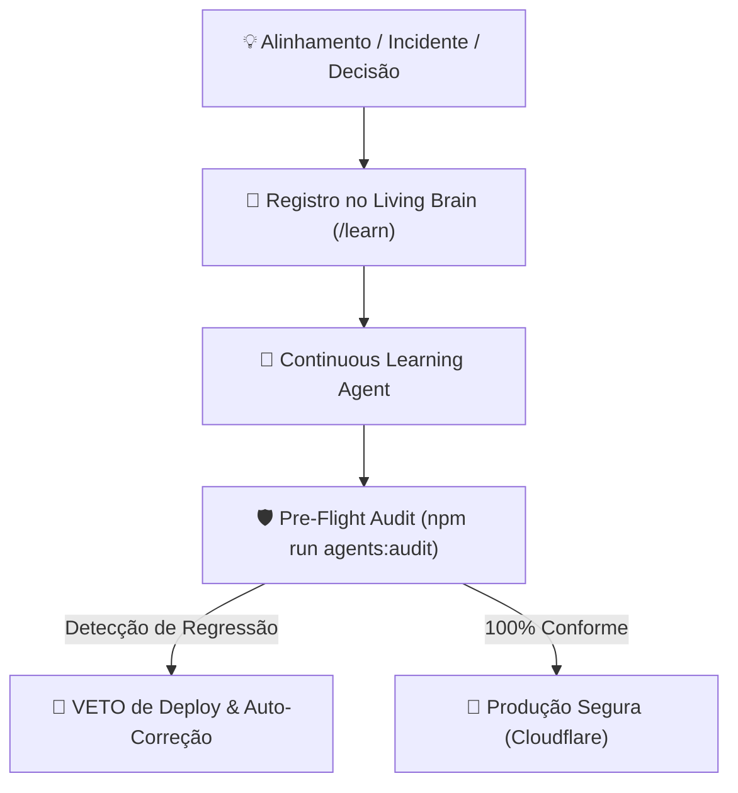

# 🧠 NETFITS — BASE DE MEMÓRIA INSTITUCIONAL E LIÇÕES APRENDIDAS (LIVING BRAIN)

> **PROPÓSITO**: Esta base de conhecimento indexa todas as decisões arquiteturais, incidentes superados, regras regulatórias e alinhamentos estratégicos do fundador André Gallo. O **Continuous Learning Agent** audita o código continuamente contra estas lições para garantir **tolerância zero a regressões**.

---

---

## 📚 Catálogo Canônico de Lições Aprendidas

### 🩺 `LL-001` — Compliance Médico CFM dos Sócios Fibios
* **Severidade**: `CRITICAL`
* **Origem**: Exigência regulatória do Conselho Federal de Medicina (CFM / Codame / RQE).
* **Fato**: Dra. Isabella Formigari (CRM-SP 282951) e Dr. Franco Merici (CRM-SP 212567) estão concluindo suas especializações médicas.
* **Regra Inegociável**: É estritamente vedado atribuir a eles titulação de especialista (ex: Medicina do Esporte, Ortopedia ou Nutrologia) em qualquer tela ou comunicação pública. A assinatura oficial única é:
  * `Dr. Franco Merici: Médico (CRM-SP 212567) sócio fundador da Fibios`
  * `Dra. Isabella Formigari: Médica (CRM-SP 282951) sócia fundadora da Fibios`

---

### ☁️ `LL-002` — Exclusividade Cloudflare Workers
* **Severidade**: `CRITICAL`
* **Origem**: Descomissionamento de provedores legados (Vercel) em prol de arquitetura serverless de borda ultra-rápida.
* **Regra Inegociável**: Toda a infraestrutura oficial da Netfits roda exclusivamente no **Cloudflare Workers / Nitro preset cloudflare-module** (`www.netfits.com.br`). Qualquer dependência ou referência a Vercel é proibida.

---

### 📱 `LL-003` — Paridade Cross-Platform Mobile (Android & iOS)
* **Severidade**: `CRITICAL`
* **Origem**: Incidentes de tela preta e bloqueios de bot-shield no Android ao presumir comportamento exclusivo de iOS/WebKit.
* **Regra Inegociável**: Nenhuma tela, botão, fluxo de login ou integração de hardware pode ser mono-plataforma. Tudo deve ser projetado, testado e validado tanto no **Android (Chromium WebView & Chrome Custom Tabs)** quanto no **iOS (WebKit & Safari)**.

---

### 🎨 `LL-004` — Key Visual, Design Tokens e Tipografia Oficial (Manifesto 3.0)
* **Severidade**: `HIGH`
* **Origem**: Desvios visuais em cores institucionais e legibilidade WCAG.
* **Regra Inegociável**: Cores oficiais:
  * Roxo Escuro Institucional: `#35106E`
  * Roxo Vibrante Destaque: `#6B2AD9`
  * Verde-Limão Movimento: `#C8F135`
  * Verde Oliva Logo: `#5D7600`
  * Lavanda Sutil: `#F2ECFD`
  * Barra bipartida (`#6B2AD9` + `#C8F135`) obrigatória em 100% dos cards do feed. Tipografia *Inter*.

---

### 🗣️ `LL-005` — Proibição de Jargões Corporativos na Interface
* **Severidade**: `HIGH`
* **Origem**: Inserção de termos contábeis internos (ex: FEFO, take-rate, CAC) em textos voltados ao usuário.
* **Regra Inegociável**: O usuário nunca deve ver termos como "FEFO" ou "take-rate". A linguagem deve ser clara, acolhedora e pedagógica: *"pontos com vencimento mais próximo primeiro"*.

---

### 🏷️ `LL-006` — Padronização Canônica: "Pílula de Sabedoria"
* **Severidade**: `MEDIUM`
* **Origem**: Variações confusas misturando as marcas (ex: "Pílula de Sabedoria Fibios", "Pílula Netfits").
* **Regra Inegociável**: O takeaway no rodapé dos cards educativos deve se chamar estritamente **`Pílula de Sabedoria`**.

---

### 🔒 `LL-007` — Blindagem de Quiz-Locking e Travas Antifraude
* **Severidade**: `CRITICAL`
* **Origem**: Usuários conseguiam responder quizzes sem ler artigos/ver vídeos, e a leitura de 0 nfs consumia o teto diário de interações.
* **Regra Inegociável**: O Quiz permanece **bloqueado com cadeado (`🔒`)** até que o dwell time de 10s e rolagem 100% (ou 90% do vídeo) sejam auditados. Ações de 0 nfs **nunca** contam no limite diário de interações bonificadas.

---

### 🧭 `LL-008` — Arquitetura Canônica das 4 Abas Inferiores
* **Severidade**: `CRITICAL`
* **Origem**: Textos desatualizados citavam "Perfil" na barra inferior.
* **Regra Inegociável**: As 4 abas estruturais da barra inferior são:
  1. **Feed** (`/feed`)
  2. **Shop** (`/market`)
  3. **Clube** (`/club`)
  4. **Carteira** (`/wallet`)  
  *O Perfil é acessado exclusivamente pelo avatar no cabeçalho superior.*

---

### 🛑 `LL-009` — Protocolo Cirúrgico Obrigatório de Deploy
* **Severidade**: `CRITICAL`
* **Origem**: Merges indiscriminados de staging arrastando telas experimentais para produção.
* **Regra Inegociável**: Proibição absoluta de `git merge staging`. Subidas em `main` são feitas cirurgicamente (cherry-pick), com sanitização de diff e aprovação formal explícita ("sim") do fundador.

---

### 💎 `LL-010` — Parâmetros Operacionais Canônicos do Clube Netfits
* **Severidade**: `HIGH`
* **Origem**: Inconsistências de valores e pontuações do Clube entre componentes.
* **Regra Inegociável**:
  * Assinatura: **R$ 19,90 / mês**
  * Pontos fixos: **250 nfs** na adesão e a cada mensalidade
  * Treinos com relógio/sensores: **20 nfs por treino validado via Terra API**
  * Shop: **20% mais pontos** (4,8 nfs por R$ 1,00)
  * MGM: **10% de comissão** em pontos sobre as compras de todos os seus indicados.

---

## 🔄 Como Ensinar o Agente Continuamente?
Sempre que uma nova regra for decidida ou um incidente for resolvido:
1. No chat, você pode usar o comando **/learn** ou instruir: *"aprenda que X agora é a regra"*;
2. O agente adicionará a nova entrada em `src/lib/knowledge/LESSONS_LEARNED.json` e registrará o teste de anti-regressão correspondente.

---

### 🛡️ LIÇÃO LL-011: ATOMICIDADE TRANSACIONAL DISTRIBUÍDA & PROIBIÇÃO DE MUTAÇÃO CLIENT-SIDE
* **ID Canônico**: `LL-011`
* **Gravidade**: `CRITICAL` (Poder de Veto Imediato)
* **Origem**: Auditoria de Produção de 07/11/2026 — Reconciliação de Pontos e MGM
* **Contexto**: Incidentes em produção de usuários cadastrados sem persistência no banco e padrinhos que não receberam bônus MGM (+50 nfs) ocorreram porque o navegador do novo membro tentava mutar o saldo do padrinho em seu localStorage local, e a sincronização com o banco era chamada sem await/keepalive antes de redirecionar a tela.
* **Regras Inegociáveis**:
  1. **Proibição de Mutação de Terceiros no Client-Side**: É terminantemente proibido calcular ou somar pontos para qualquer outro usuário que não seja o usuário ativo daquela sessão no dispositivo local. Bonificações de padrinho (MGM) DEVEM ser processadas e creditadas exclusivamente no servidor central (`/api/users-sync`).
  2. **Persistência Antes do E-mail**: E-mails transacionais que comemoram créditos de pontos (boas-vindas, indicações) SÓ PODEM ser disparados após o banco de dados confirmar a gravação atômica da conta e da transação no ledger.
  3. **Transporte Resiliente (Keepalive & Await)**: Chamadas de sincronização de cadastro e transações na nuvem DEVEM utilizar `await` obrigatório e flag `keepalive: true` no `fetch()` para blindar contra cancelamentos abruptos por troca de página ou fechamento de abas móveis.
* **Anti-patterns Proibidos**: `referrer.nfsBalance +=`, chamadas de sync sem `await` antes de `navigate()`.
